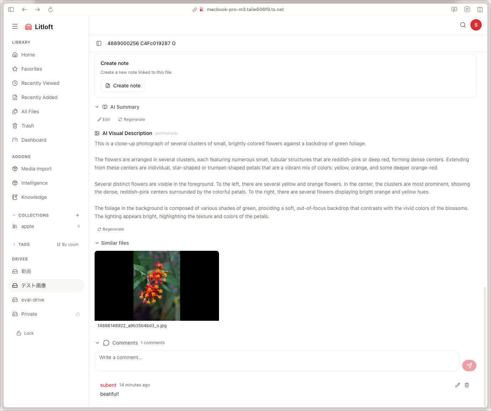

# Comments and watch history

Both need a nickname. Set one on the **Settings** page: see [profile and preferences](profile-preferences.md). There are no accounts: anyone who types the same nickname is the same person to Litloft, and a different nickname is a different person.

## Comments

Each file has one list of comments, at the bottom of its page under **Comments**. Type in **Write a comment...** and press **Post**.

- Without a nickname you see **Set up a profile to post comments**.
- Comments are plain text, up to 1000 characters. Markdown is not formatted, and there are no replies.
- You can post 10 comments a minute. After that you see **Too many comments. Please try again later**.
- A file holds at most 500 comments.

**Edit** and **Delete** appear only on your own comments. Nobody, including an administrator, can edit or delete someone else's comment in the app.

## Watch history

Litloft records each file you open, and for video, audio, PDFs, EPUBs, archives and long text, where you stopped. Home shows two rows from this:

- **Continue**: files you started (at least 3% in), have not finished (under 90%), and opened within the last two weeks. Files you set aside here stay out of this row.
- **Recently Viewed**: every file you opened that is not on the Continue desk, including ones you finished and ones you set aside.

Watching to the end keeps the file in **Recently Viewed** and takes it out of **Continue**. Litloft cannot tell when a live stream or a video embedded from another site has ended, so these are never marked as finished.

History belongs to one drive. Use the same nickname on your phone and computer to share it between them.

Without a nickname, resume positions are kept only in this browser, and Home shows neither row.

### Setting an item aside

Right-click a card in **Continue** on Home, or long-press it on a touch screen, and choose **Remove from Continue**. The file leaves **Continue**; its resume position is kept, and it appears in **Recently Viewed** when it is among the newest files there. Opening the file again puts it back in **Continue**.

### Removing an item

Right-click a card in **Continue** or **Recently Viewed** on Home, or long-press it on a touch screen, and choose **Remove from history**. This deletes the history row, so the card leaves both rows and the resume position is lost. Items are removed one at a time; there is no way to clear the whole history.

Clearing your nickname or your cookies does not delete your history. Enter the same nickname again and it comes back.

## Privacy

Only you can see your own history. There is no list of who watched what, even for an administrator, and no list of nicknames.
