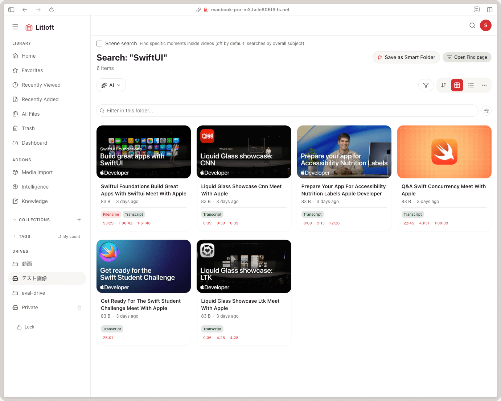
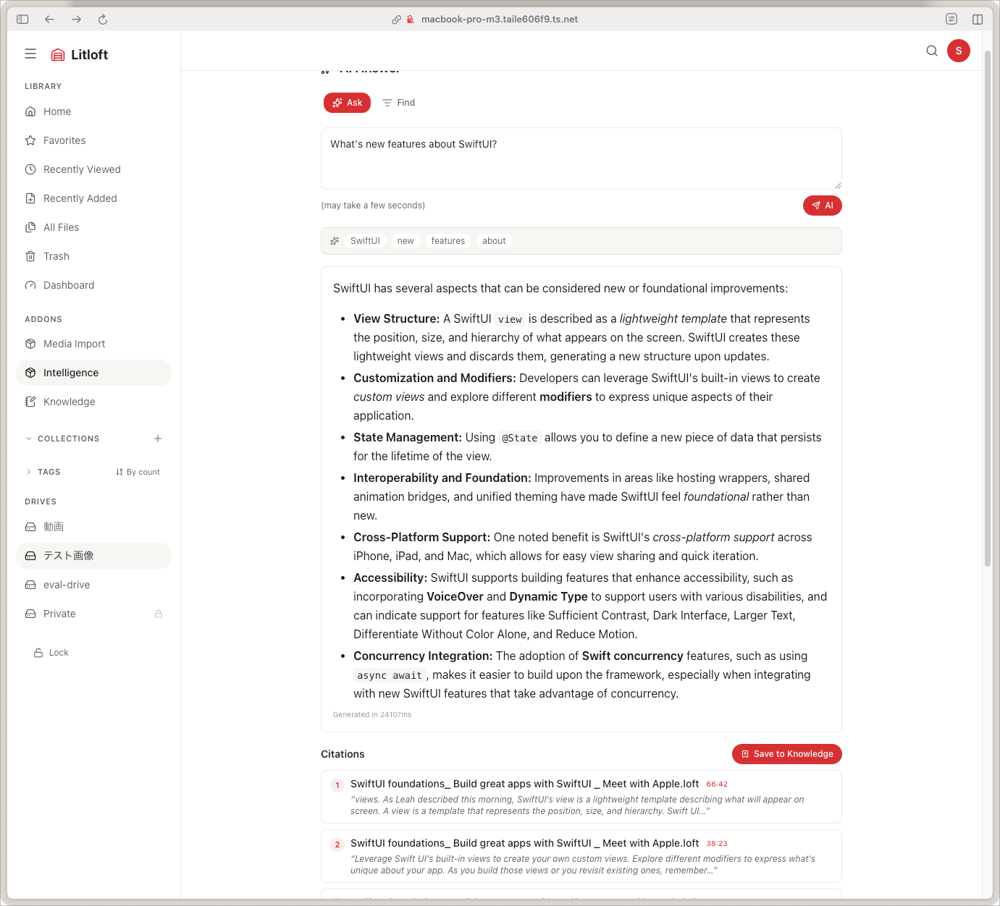

# Search

Search looks inside one drive at a time. It never shows files from another drive.

Without addons, search matches file titles and folder names. With the [intelligence addon](../addons/intelligence.md) it also finds files by meaning: what is said in a video, what a picture shows, and the text inside documents.

## The search modal

Press `Cmd/Ctrl+K` or `Cmd/Ctrl+Shift+F`, or the search button in the header. See [keyboard shortcuts](keyboard-shortcuts.md#global).

Before you type, the modal lists **Recent files** (the files you opened lately in this drive, on any device where you use the same [profile](profile-preferences.md)), and then your **Recent searches** in this browser. Each recent search has one button that puts the term in the field without running it, and one that removes it.

Once you type, the modal shows the best matches and a **View all N results** row that opens the full search page. Use the arrow keys to pick a row and `Enter` to open it.

Typing the name of a page, such as "all files" or "trash", or of a pin, collection or Smart Collection, also shows a **Go to** row above the files that takes you straight there. Folders whose name matches, at any depth, are listed under **Folders** just below, with the folder they are in. These are the first rows the down arrow reaches; `Enter` with no row picked still opens the full search page.

To walk the folders instead, press `→` on a folder row, or type `/` in an empty field to start at the top of the drive. The `/` has to be typed directly: one typed through a Japanese or other input method is searched for as text, so switch to direct input first or use `→`. The modal then lists what is inside that folder, and typing narrows the list by name. `←` or `Backspace` in an empty field goes back up. On a touch screen, tap `›` at the end of a folder row to go in, and `‹` on the folder chip to go up.

With the intelligence addon, the footer says **Also searching by meaning…** while the second set of results is on its way. When it arrives the list can reorder. The row you picked stays picked.

### Narrowed to one kind

With the Knowledge addon installed, opening the modal from a note's page narrows it to notes. A **Notes** chip appears before the query. Then:

- Only notes are listed, and only by name.
- `Enter` with no row chosen opens the [Notes Library](notes.md#library) with your query in its search field. The same link is at the bottom right of the modal. The Library's search, like this one, matches titles and folder names.
- To search the whole drive instead, press the chip's `×`, or `Backspace` in an empty field. What you typed stays.

## The search page

The search page matches the title and the folder path, ignoring case. A title starts as the filename without its extension, so you can search by filename. If you change a file's title, search sees the new title. Descriptions are not searched.

Each result has a small badge saying where it matched, such as **Filename** or **Path**. **What the badges mean**, at the bottom of the search popup, explains them all.

The top of the page is also the query field. It holds what you searched for, and you can edit it and press `Enter` to search again; `Esc` puts the current query back. Each operator in the field gets a chip underneath it, and `×` on a chip removes that operator from the query and searches again. Typing an operator shows its chip at once, before you submit.

After the chips, **＋ 条件** adds an operator without typing the syntax: **タグ** (tag), **種類** (type), **フォルダ** (folder), **コレクション** (collection), **サイズ** (size), **長さ** (length), **更新日** (modified), **お気に入り** (favourites), **タグなし** (untagged) or **コレクション未登録** (in no collection). Tag, folder and collection open a list of values; the collection list holds collections and Smart Collections together, each with its own icon. Each list has a filter box, and a value already in the query is not offered, in either polarity. Size and length open fixed presets such as **1 GB 以上** and **30 分以上**; **更新日** opens **30 日以内**, **1 年以上前** and **3 年以上前**. A preset already in the query, or one that would contradict it, is not offered. **タグなし** and **コレクション未登録** write `-has:tag` and `-has:collection` and search at once. Picking a value adds it to the query and searches.

Under the chips is the results bar. It holds, in order, the **ファイル / 箇所** switch (with the intelligence addon), **シーン検索**, the number of results, **View**, **Sort** and `…`. On a phone **View** and **Sort** are in `…`.

- **Sort** offers **Relevance** (the default while searching) plus the usual folder orders.
- `…` holds **Save as Smart Collection** and **選択モード**.
- A file type is chosen with **＋ 条件** → **種類**, which writes `type:<kind>` into the query. A type that arrives in the address — from the search window or a Smart Collection — shows as a **種類** chip in the row under the field; `×` on the chip removes it.

To filter by tag, kind or favourite, type an operator; see [Operators](#operators). The sidebar's tags also filter a folder; see [Tag filtering](#tag-filtering).

## Operators

Words of the form `name:value`, typed in the search window or on the search page, filter the results instead of being searched for:

| Operator | Keeps | Several |
|---|---|---|
| `tag:trip` | files with the tag `trip` | every tag must be on the file |
| `type:video` | files of that kind: `video`, `image`, `audio`, `document`, `text`, `pdf`, `archive`, `other` | any of the kinds |
| `path:Work/2024` | files in that folder and its subfolders, comparing the folder name case-sensitively | any of the folders |
| `in:trip` | files in the collection named `trip`, or in the Smart Collection named `trip` (its Files view), ignoring case | any of the collections |
| `size:>1GB` | files larger than 1 GB, in binary units: `B`, `KB`, `MB`, `GB`, `TB`, where `1KB` is 1024 bytes | every comparison must hold |
| `duration:>=30m` | video and audio at least 30 minutes long: `s`, `m`, `h`, `1h30m`, `1:30` or `1:05:00` | every comparison must hold |
| `modified:<2024`, `modified:>=2024-06`, `modified:<1y` | files last changed before, or since, a date or a length of time: `2024`, `2024-06` and `2024-06-05` (a `/` works in place of each `-`), or `d`, `w`, `m`, `y` counted back from today, such as `30d` and `1y` | every comparison must hold |
| `is:favorite`, `is:liked` | favourites, liked files | both |
| `has:tag`, `has:collection` | files with at least one tag, files in at least one collection | with `-`, the files with no tag or in no collection |

A size, a length and a modification time need a comparison: `>`, `>=`, `<` or `<=`. Write a range as two comparisons side by side, such as `size:>100MB size:<1GB`, `duration:>=5m duration:<1h` or `modified:>=2024-06 modified:<2024-07`. A value without a comparison, or one that does not parse, is searched as ordinary text. A file with no duration, such as a document or a picture, never matches a `duration:` comparison.

Put `-` before `tag:`, `type:`, `path:`, `in:`, `is:`, `has:` to exclude what it names: `tag:trip -tag:2023` keeps files tagged `trip` and not `2023`, and `-path:Work` alone lists every file outside `Work`. The exclusion takes the same values as the operator it negates, and its chip reads **除外** before the operator's name. `-in:` excludes regular collections only; a name that only a Smart Collection carries is refused, and the results are replaced by a notice, because its members would have to be worked out first. A size, a length, a modification time and a plain word take no `-`: for the first three the opposite comparison says the same, and a meaning search cannot exclude a meaning. A Smart Collection whose query uses `-` or `has:` serves as the target of Video, Reading, Notes and Clips up to 10,000 files.

`<` means before: `modified:<2024` lists files last changed before 2024 began, and `<=2024` includes the whole year, so `modified:<=2023` and `modified:<2024` are the same. Dates are read in your own time zone at local midnight. Counted lengths are fixed (`1m` is 30 days, `1y` is 365), not calendar months or years. A Smart Collection saved with `modified:<1y` keeps meaning "a year before today" each time it runs. A change made outside Litloft shows only after the next scan of the drive.

`tag:trip type:image kyoto` finds images tagged `trip` whose name or folder contains "kyoto". Operators alone, such as `tag:trip`, list every file that passes them, newest first. A word that is not one of these operators, or a value that is not one of these values, is searched as ordinary text. Put a value with spaces in quotes: `path:"My Photos/2024"`, `in:"読書 メモ"`, `tag:"two words"`. In the search window, typing `tag:`, `type:` or `is:` lists the values you can use, the drive's most used tags first; pick one with the arrow keys and `Enter` to complete it.

With the intelligence addon, operators also filter the files found by meaning: `tag:会議 type:pdf 予算の見直し` searches for the meaning of 「予算の見直し」 among files tagged 会議 and of kind PDF. Operators alone, with no other words, list files only and run no meaning search. Scene search is off while an operator is in the query. A type in the address — shown as the **種類** chip — still applies, together with any `type:`.

## Saving as a Smart Collection

In the results bar, open `…` and choose **Save as Smart Collection**, then give it a name. It appears in the sidebar's **Collections** section, and the `…` menu then shows **Saved:** followed by the name, with **Overwrite**, **Rename** and **Delete**.

When the conditions of an open Smart Collection differ from what it saved — a new query, a condition added or removed, or a different type — **上書き保存 / Overwrite** appears at the right end of the row under the field, and the `…` row of the same name is enabled. Either saves the conditions on screen into that Smart Collection without asking; once they match the saved ones, the button goes and the row is disabled.

- A Smart Collection keeps the query and the file type. A tag is kept when it is written into the query as `tag:`.
- It always shows the files that match now, not the ones that matched when you saved it.
- Only the **Video**, **Image**, **Audio** and **Document** types can be saved. Use **Document** for Markdown and PDFs. Saving with another type shows an error.
- A search whose `in:` names a Smart Collection cannot be saved, because expanding it again would nest one Smart Collection inside another. The save is refused and nothing is written; rename or edit the query first.
- Everyone who uses the drive sees the same Smart Collections.

On a saved Smart Collection's page, while it shows the saved query and type in **ファイル**, **再生 / Play** plays its video and audio. The files play as a queue in the order shown, and when a file ends the next one opens. The queue is fixed when you press Play: later changes to the Smart Collection do not alter it, and only the next Play replaces it. Play is absent when the results hold no video or audio; on a phone it is the first row of the `…` sheet.

With the intelligence addon, `…` also holds **ここに質問 / Ask here**, which opens Ask scoped to this Smart Collection. See **Ask** below.

## Tag filtering

Click a tag in the **Tags** section of the sidebar. It filters the folder you are in and all its subfolders. See [tags and relations](tags-and-relations.md#tag-filtering-and-scope).

## Searching by meaning (intelligence addon)

With the intelligence addon enabled for the drive, results found by meaning are mixed into the same list. There is no separate mode.

- The badges also show matches in **Transcript**, **Content**, **Visual**, **Thumbnail** and **Metadata**.
- Pictures and video frames found by how they look (**Thumbnail**, **Visual**) can be only loosely related to your words. In relevance order they usually come after other matches.
- Text inside pictures, such as screenshots, slides and photos of signs, is found by its words in search and Ask, and a match shows the recognised text as its quote. A reading can contain single-character errors. To fix one, open the picture's page and use the **画像の文字** (Text in image) section: **修正** (Edit), then **保存** (Save). Search uses the corrected text from then on, and **元の結果に戻す** (Restore original) puts back what the engine read.
- Text shown in a video — a slide, terminal output, a caption burned into the picture — is found by its words too. A video found this way shows 内容一致; its time and 「画面内の文字」 appear under 箇所. The text on a scanned PDF page is found as that page's text.
- A match in speech or in a scene shows up to three timestamps. Click one to play from that moment. `+N` says how many more there were.
- A match in a PDF lists the pages, as `p.N`. Click one to open the PDF at that page.
- PDF text can include vertical writing. A phrase split across lines may not match as one continuous phrase, and some isolated vertical characters on mixed-layout pages can be missed.
- A match in an EPUB book lists the chapters by title. Click one to open the book at the start of that chapter.
- A match in text shows one quote from the file. With the [Knowledge addon](../addons/knowledge.md), a button beside it adds the quote to the capture basket for a note.

### Files and passages

While a meaning search runs, a **ファイル / 箇所** switch sits in the results bar above the results. **ファイル** lists the files that matched, as before. **箇所** lists the places where the search found something, in order of relevance, with a count of files and places in the bar.

- Each row shows a frame or the file's thumbnail, the place (a time range, page or chapter), the file name and the matched text in full. A picture's recognised text and a plain text match are labelled accordingly.
- For text shown in a video, the picture starts as the whole frame and then becomes a close-up of the line the words are on, once the larger frame has loaded. Clicking such a row opens the video at that moment with the matched word already in [find in this file](viewers-and-players.md#finding-in-this-file); while the playhead is inside that moment, the player outlines the matched line on the picture.
- Click a row to open the file at that time, page or chapter.
- **箇所** shows only places inside files: speech, PDF pages, chapters, text in a picture, text shown in a video (「画面内の文字」 with its time), and scenes when **Scene search** is on. A file found only by its name or thumbnail appears only under **ファイル**.
- A file shows up to three places. When it has more, **このファイルの他の箇所 →** opens the file with [finding in this file](viewers-and-players.md#finding-in-this-file) already searching for the word that matched there.
- The list holds the best-matching passages the search kept, not every occurrence of your words in a file. Finding in the file lists every occurrence.
- If nothing was found inside files, **ファイルで表示** switches back to the files that matched.

The switch is part of the address, so a link can open the results straight in **箇所**. A search started from the modal on the same page keeps the view.

At the end of the results, **Show more by similarity** adds more pictures from the drive in order of how closely they look like what you asked for; click it once, then keep scrolling as the rest arrive a hundred at a time. When the query has operators, the extra pictures are filtered by them too, and Scene search stays off.

### Scene search

To find a moment inside a video (*the part where the cat jumps off the table*), turn on **Scene search** in the results bar above the results. It is off by default because it adds noise to ordinary searches.

With it on, **Scene candidates** appear above the results: a grid of moments from videos in the drive, each with a frame, the file name and a time range. Click one to open the video at that time. The first eight candidates are shown; **Show all** expands the remaining candidates, and **Collapse** returns to the first eight. They are the closest matches, not a promise that the scene exists, and the grid is not shown when the search uses a Smart Collection or a type other than video.

A YouTube reference can be found this way too, by a moment of the video, and opens at that time; its card shows a small picture from that moment. A reference saved before the administrator installed this version has no moments to find, and no pictures, until its **Image analysis (CLIP)** is regenerated from **Index details**.

## Searching by an image (intelligence addon)

Give the search an image instead of words: paste it, drop it on the search page, or click **Search by image** in the search window or in the results page's field. On a phone the **Search by image** pill sits under the field. The search window also accepts a drop on its panel.

The results page shows up to three groups:

- **Documents with this text** — documents whose text matches the words read from the image. This is what finds a screenshot of a PDF page or a slide, and the group comes first when it has a hit.
- **Similar pictures** — pictures of the drive that look like it.
- **Similar scenes in videos** — places in the drive's videos where a similar scene appears.

The image is not saved. Reloading the page or opening the same link in another tab asks you to choose the image again. A picture can be up to 20 MB and 50 megapixels; a larger one is scaled down in the browser when the browser can read it.

The documents group needs readable text in the image — about 20 characters — and **Text in pictures** turned on for the drive (see [text in pictures](../addons/intelligence.md#text-in-pictures)). A picture with no readable text still returns similar pictures and scenes. An image search does not combine with operators, a type filter or text, and it cannot be saved as a Smart Collection.

## Ask (intelligence addon)

**Ask** is in the sidebar when the intelligence addon is installed and an administrator has set up a language model. Type a question and it answers from your files, with links to its sources and timestamps for videos. It warns you when it found no strong source. Ask answers only from [verified files](file-browsing.md#trusted-sources-and-the-review-queue).

When more than one model is available, a select beside the **Ask** button picks the model for your questions; **Auto** uses the one the administrator assigned. It goes back to **Auto** when you reopen the page or switch drives. AI summaries have the same choice under the **▾** beside **Create again**.

To ask about one file, open it and use the **Ask** tab beside its details; the answer cites times, pages or sections you can click to jump there. The tab appears once the file has been indexed, a little after upload. A picture that has no text can be asked about when a model that can read images is set up. A video with no speech and no text on screen can be asked about the same way; its answer comes from a handful of frames of the video, and a time in the answer jumps to that frame. A question about a video that has speech or text on screen also sends a handful of its frames when the model can read images, so it can be about what the video shows; the answer can take up to 45 seconds longer to start. When those frames do not show what the question is about, the model can look at up to 12 more moments it picks from what is said in the video, which adds a few seconds per look. On a long video whose text the answer read only part of, it can instead read more of what is said and shown in parts it picks; it makes at most 3 such looks or reads in all. An answer that needs no more frames appears all at once rather than word by word. On a PDF, the model can look at pages it picks when the question is about a figure, a table or how a page looks; on a long PDF or EPUB whose text the answer read only part of, it can also read more of the text from a page, chapter or passage it picks. It makes at most 3 such looks or reads, and these answers also appear all at once. While a video or audio file is playing, a question can be about that moment. When the answer was meant to use an image and could not, a line under the answer says the image could not be used and the answer is from the text only.

Keep asking in the same tab: each question takes the earlier ones into account. **新しい会話** (New conversation) clears the conversation and starts over. The conversation lasts only while the page is open, and **Markdownで保存** (Save as Markdown) keeps it as a note in the drive. A note saved this way is unverified, so Ask does not use it as evidence until you press **Trust as a source** on it (see [Trusted sources](file-browsing.md#trusted-sources-and-the-review-queue)). A follow-up can say it read only part of the file even when the first question did not, because the earlier conversation shares the room available for reading the file.

Ask sends parts of your files to the language model. An administrator can use a local model, or turn Ask off for a drive. See the [intelligence addon](../addons/intelligence.md#ask-rag).

**Ask within a folder, a collection, a Smart Collection, tags or kinds.** The folder `…` menu's **ここに質問** and the collection page's **ここに質問** open Ask already narrowed to that folder (and everything under it) or that collection; a saved Smart Collection's `…` menu's **ここに質問** narrows it to the files its search page lists in **ファイル**. Under the Ask field the narrowing appears as chips; **＋ 範囲** adds another folder, collection, tag or kind, and a chip's `×` removes one. Ask answers only from those files, and says **この範囲にはファイルがありません** when the scope holds none. The folder menu entry is absent at the drive root and for a name containing a double quote, which the query syntax cannot express.

## Duplicate files

The admin dashboard has a **Duplicate Files** section. Pick a drive to see files with identical content. Choose the copy to keep, and the others go to the [trash](trash-and-missing.md).

For scripting search, see the [HTTP API reference](../reference/api.md).
