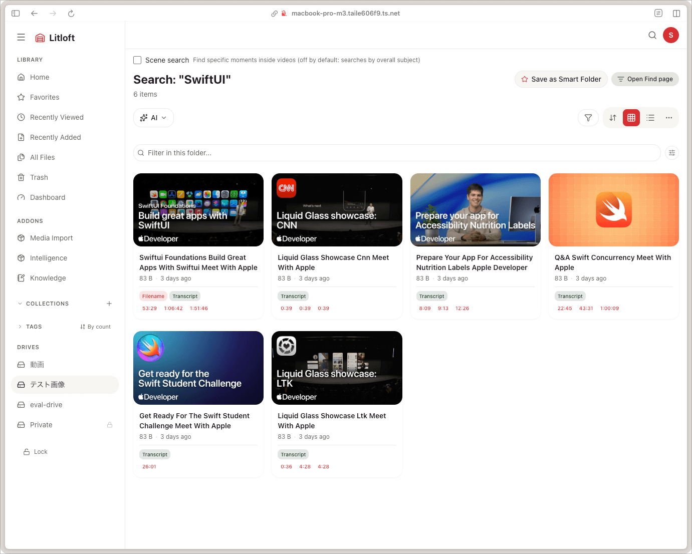
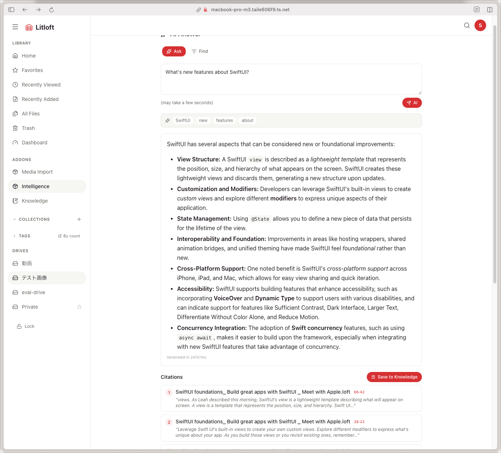

# Search

Search looks inside one drive at a time. It never shows files from another drive.

Without addons, search matches file titles and folder names. With the [intelligence addon](../addons/intelligence.md) it also finds files by meaning: what is said in a video, what a picture shows, and the text inside documents.

## The search modal

Press `Cmd/Ctrl+K` or `Cmd/Ctrl+Shift+F`, or the search button in the header. See [keyboard shortcuts](keyboard-shortcuts.md#global).

Before you type, the modal lists **Recent files** (the files you opened lately in this drive, on any device where you use the same [profile](profile-preferences.md)), and then your **Recent searches** in this browser. Each recent search has one button that puts the term in the field without running it, and one that removes it.

Once you type, the modal shows the best matches and a **View all N results** row that opens the full search page. Use the arrow keys to pick a row and `Enter` to open it.

Typing the name of a page, such as "all files" or "trash", or of a pin, collection or smart folder, also shows a **Go to** row above the files that takes you straight there. Folders whose name matches, at any depth, are listed under **Folders** just below, with the folder they are in. These are the first rows the down arrow reaches; `Enter` with no row picked still opens the full search page.

To walk the folders instead, press `→` on a folder row, or type `/` in an empty field to start at the top of the drive. The `/` has to be typed directly: one typed through a Japanese or other input method is searched for as text, so switch to direct input first or use `→`. The modal then lists what is inside that folder, and typing narrows the list by name. `←` or `Backspace` in an empty field goes back up. On a touch screen, tap `›` at the end of a folder row to go in, and `‹` on the folder chip to go up.

With the intelligence addon, the footer says **Also searching by meaning…** while the second set of results is on its way. When it arrives the list can reorder. The row you picked stays picked.

### Narrowed to one kind

With the Knowledge addon installed, opening the modal from a note's page narrows it to notes. A **Notes** chip appears before the query. Then:

- Only notes are listed, and only by name.
- `Enter` with no row chosen opens the full list of notes matching your query, **All notes**. The same list is linked at the bottom right of the modal.
- To search the whole drive instead, press the chip's `×`, or `Backspace` in an empty field. What you typed stays.

## The search page

The search page matches the title and the folder path, ignoring case. A title starts as the filename without its extension, so you can search by filename. If you change a file's title, search sees the new title. Descriptions are not searched.

Each result has a small badge saying where it matched, such as **Filename** or **Path**. **What the badges mean**, at the bottom of the search popup, explains them all.

The top of the page is also the query field. It holds what you searched for, and you can edit it and press `Enter` to search again; `Esc` puts the current query back. Each operator in the field gets a chip underneath it, and `×` on a chip removes that operator from the query and searches again. Typing an operator shows its chip at once, before you submit.

After the chips, **＋ 条件** (**＋** on a phone) adds an operator without typing the syntax: **タグ** (tag), **種類** (type), **フォルダ** (folder), **コレクション** (collection) or **お気に入り** (favourites). Tag, folder and collection open a list of values; each list has a filter box, and a value already in the query is not offered. Picking a value adds it to the query and searches.

Above the results:

- **Filter** narrows by file type, as in a folder. **Document** includes text files and PDFs.
- **Sort** offers **Relevance** (the default while searching) plus the usual folder orders.

To filter by tag, kind or favourite, type an operator; see [Operators](#operators). The sidebar's tags also filter a folder; see [Tag filtering](#tag-filtering).

## Operators

Words of the form `name:value`, typed in the search window or on the search page, filter the results instead of being searched for:

| Operator | Keeps | Several |
|---|---|---|
| `tag:trip` | files with the tag `trip` | every tag must be on the file |
| `type:video` | files of that kind: `video`, `image`, `audio`, `document`, `text`, `pdf`, `archive`, `other` | any of the kinds |
| `path:Work/2024` | files in that folder and its subfolders, comparing the folder name case-sensitively | any of the folders |
| `in:trip` | files in the collection named `trip`, ignoring case | any of the collections |
| `is:favorite`, `is:liked` | favourites, liked files | both |

`tag:trip type:image kyoto` finds images tagged `trip` whose name or folder contains "kyoto". Operators alone, such as `tag:trip`, list every file that passes them, newest first. A word that is not one of these operators, or a value that is not one of these values, is searched as ordinary text. Put a value with spaces in quotes: `path:"My Photos/2024"`, `in:"読書 メモ"`, `tag:"two words"`. In the search window, typing `tag:`, `type:` or `is:` lists the values you can use, the drive's most used tags first; pick one with the arrow keys and `Enter` to complete it.

With the intelligence addon, operators also filter the files found by meaning: `tag:会議 type:pdf 予算の見直し` searches for the meaning of 「予算の見直し」 among files tagged 会議 and of kind PDF. Operators alone, with no other words, list files only and run no meaning search. Scene search is off while an operator is in the query. The type chosen in the toolbar still applies, together with any `type:`.

## Saving as a Smart Folder

Click **Save as Smart Folder** beside the results heading and give it a name. It appears under **Smart Folders** in the sidebar, and the button becomes **Saved:** followed by the name, with **Update**, **Rename** and **Delete**.

- A Smart Folder keeps the query, the file type and the sort. A tag is kept when it is written into the query as `tag:`.
- It always shows the files that match now, not the ones that matched when you saved it.
- Only the **Video**, **Image**, **Audio** and **Document** types can be saved. Use **Document** for Markdown and PDFs. Saving with another type shows an error.
- Everyone who uses the drive sees the same Smart Folders.

## Tag filtering

Click a tag in the **Tags** section of the sidebar. It filters the folder you are in and all its subfolders. See [tags and relations](tags-and-relations.md#tag-filtering-and-scope).

## Searching by meaning (intelligence addon)

With the intelligence addon enabled for the drive, results found by meaning are mixed into the same list. There is no separate mode.

- The badges also show matches in **Transcript**, **Content**, **Visual**, **Thumbnail** and **Metadata**.
- Pictures and video frames found by how they look (**Thumbnail**, **Visual**) can be only loosely related to your words. In relevance order they usually come after other matches.
- Text inside pictures, such as screenshots, slides and photos of signs, is found by its words in search and Ask, and a match shows the recognised text as its quote. A reading can contain single-character errors.
- Text shown in a video — a slide, terminal output, a caption burned into the picture — is found by its words too. A video found this way shows 内容一致; its time and 「画面内の文字」 appear under 箇所. The text on a scanned PDF page is found as that page's text.
- A match in speech or in a scene shows up to three timestamps. Click one to play from that moment. `+N` says how many more there were.
- A match in a PDF lists the pages, as `p.N`. Click one to open the PDF at that page.
- A match in an EPUB book lists the chapters by title. Click one to open the book at the start of that chapter.
- A match in text shows one quote from the file. With the [Knowledge addon](../addons/knowledge.md), a button beside it adds the quote to the capture basket for a note.

### Files and passages

While a meaning search runs, a **ファイル / 箇所** switch sits under the query field. **ファイル** lists the files that matched, as before. **箇所** lists the places where the search found something, in order of relevance, with a count of files and places above the list.

- Each row shows a frame or the file's thumbnail, the place (a time range, page or chapter), the file name and the matched text in full. A picture's recognised text and a plain text match are labelled accordingly.
- Click a row to open the file at that time, page or chapter.
- **箇所** shows only places inside files: speech, PDF pages, chapters, text in a picture, text shown in a video (「画面内の文字」 with its time), and scenes when **Scene search** is on. A file found only by its name or thumbnail appears only under **ファイル**.
- A file shows up to three places. When it has more, **このファイルの他の箇所 →** opens the file with [finding in this file](viewers-and-players.md#finding-in-this-file) already searching for the word that matched there.
- The list holds the best-matching passages the search kept, not every occurrence of your words in a file. Finding in the file lists every occurrence.
- If nothing was found inside files, **ファイルで表示** switches back to the files that matched.

The switch is part of the address, so a link can open the results straight in **箇所**. A search started from the modal on the same page keeps the view.

At the end of the results, **Show more by similarity** adds more pictures from the drive in order of how closely they look like what you asked for; click it once, then keep scrolling as the rest arrive a hundred at a time. When the query has operators, the extra pictures are filtered by them too, and Scene search stays off.

### Scene search

To find a moment inside a video (*the part where the cat jumps off the table*), turn on **Scene search** above the results. It is off by default because it adds noise to ordinary searches.

With it on, **Scene candidates** appear above the results: a grid of moments from videos in the drive, each with a frame, the file name and a time range. Click one to open the video at that time. The first eight candidates are shown; **Show all** expands the remaining candidates, and **Collapse** returns to the first eight. They are the closest matches, not a promise that the scene exists, and the grid is not shown when the search uses a smart folder or a type other than video.

## Searching by an image (intelligence addon)

Give the search an image instead of words: paste it, drop it on the search page, or click **Search by image** in the search window or in the results page's field. On a phone the **Search by image** pill sits under the field. The search window also accepts a drop on its panel.

The results page shows up to three groups:

- **Documents with this text** — documents whose text matches the words read from the image. This is what finds a screenshot of a PDF page or a slide, and the group comes first when it has a hit.
- **Similar pictures** — pictures of the drive that look like it.
- **Similar scenes in videos** — places in the drive's videos where a similar scene appears.

The image is not saved. Reloading the page or opening the same link in another tab asks you to choose the image again. A picture can be up to 20 MB and 50 megapixels; a larger one is scaled down in the browser when the browser can read it.

The documents group needs readable text in the image — about 20 characters — and **Text in pictures** turned on for the drive (see [text in pictures](../addons/intelligence.md#text-in-pictures)). A picture with no readable text still returns similar pictures and scenes. An image search does not combine with operators, a type filter or text, and it cannot be saved as a Smart Folder.

## Ask and Find (intelligence addon)

**Ask** is in the sidebar when the intelligence addon is installed and an administrator has set up a language model. Type a question and it answers from your files, with links to its sources and timestamps for videos. It warns you when it found no strong source. Ask answers only from [verified files](file-browsing.md#trusted-sources-and-the-review-queue).

**Find**, the tab beside Ask, returns a list of files for your question instead of a written answer. While you are searching, the **Find** chip in the search page header sends your query there.

When more than one model is available, a select beside the **Ask** button picks the model for your questions; **Auto** uses the one the administrator assigned. It goes back to **Auto** when you reopen the page or switch drives. AI summaries have the same choice under the **▾** beside **Create again**.

To ask about one file, open it and use the **Ask** tab beside its details; the answer cites times, pages or sections you can click to jump there. The tab appears once the file has been indexed, a little after upload.

Ask sends parts of your files to the language model. An administrator can use a local model, or turn Ask off for a drive. See the [intelligence addon](../addons/intelligence.md#ask-rag).

## Duplicate files

The admin dashboard has a **Duplicate Files** section. Pick a drive to see files with identical content. Choose the copy to keep, and the others go to the [trash](trash-and-missing.md).

For scripting search, see the [HTTP API reference](../reference/api.md).
